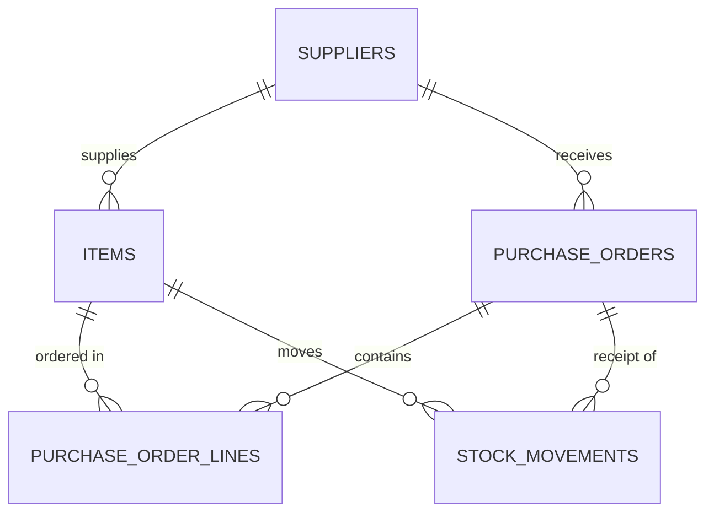

# Store Inventory (Oracle SQL + PL/SQL)

A small **personal learning project** for practicing Oracle SQL and PL/SQL on a realistic store domain: suppliers, items, purchase orders and stock movements.

This repository is my own practice work while learning Oracle. It was not built for a real shop, a customer or a team, and it is not production software. Everything in it can be explained line by line — see [docs/WALKTHROUGH.md](docs/WALKTHROUGH.md).

## Tables

| Table | What it holds |
| --- | --- |
| `suppliers` | Who we buy from (name, contact, active flag) |
| `items` | What we keep in stock: sku, price, `quantity_on_hand`, `reorder_point` |
| `purchase_orders` | Orders sent to a supplier, with a status (`DRAFT` → `ORDERED` → `RECEIVED`, or `CANCELLED`) |
| `purchase_order_lines` | The items and quantities inside one purchase order |
| `stock_movements` | Every `IN` and `OUT` of the warehouse: item, quantity, date, reason |

## How the tables relate



One supplier has many items and many purchase orders. One purchase order has many lines, and each line points to one item. Every stock movement belongs to one item; a movement created by receiving a PO also points back to that PO.

## PL/SQL in this project

- `inventory_pkg` — `receive_po`, `issue_stock`, `get_stock`, and a named exception `e_insufficient_stock` (ORA-20001).
- `trg_movements_ai` — an `AFTER INSERT` trigger on `stock_movements` that adds or subtracts `items.quantity_on_hand`.
- `trg_items_biu` — a `BEFORE INSERT OR UPDATE` trigger on `items` that sets `updated_at`.
- `v_low_stock` — items at or below their reorder point, with the supplier name.
- `v_po_summary` — number of purchase orders and total value per supplier.

## Files

```
schema/00_drop_all.sql       drop everything (safe to re-run)
schema/01_create_tables.sql  the five tables
schema/02_seed_data.sql      sample data
plsql/01_inventory_pkg.sql   package spec + body
plsql/02_triggers.sql        two triggers
plsql/03_views.sql           two views
tests/test_inventory.sql     eight PASS/FAIL checks
docs/WALKTHROUGH.md          what each script does and why
docs/INTERVIEW_QUESTIONS.md  20 questions about this repository
```

## How to run

Run the scripts **in this order**; each one depends on the previous one.

1. `schema/00_drop_all.sql`
2. `schema/01_create_tables.sql`
3. `schema/02_seed_data.sql`
4. `plsql/01_inventory_pkg.sql`
5. `plsql/02_triggers.sql`
6. `plsql/03_views.sql`
7. `tests/test_inventory.sql`

### Option A — free workspace at apex.oracle.com

1. Create (or sign in to) a free workspace at [apex.oracle.com](https://apex.oracle.com).
2. Open **SQL Workshop → SQL Scripts → Upload** and upload the first file, then click **Run**. Check that the results page shows no errors.
3. Repeat for the remaining files, in the order above.
4. To run the tests one block at a time, use **SQL Workshop → SQL Commands**: paste one block (from `DECLARE` to the closing `/`), click **Run**, and read the result in the DBMS Output tab.

### Option B — local Oracle Database Free

1. Start a database with Docker (Oracle Database Free, 23ai). Pick your own
   password: the image refuses weak ones, so use at least 8 characters with
   upper case, lower case and a number.

   ```bash
   docker run -d --name oracle-free -p 1521:1521 \
     -e ORACLE_PASSWORD='YourPassword1' \
     container-registry.oracle.com/database/free:latest
   ```

2. Create a normal user for the project (do not put application tables in SYSTEM):

   ```sql
   sql sys/YourPassword1@localhost:1521/FREE as sysdba

   CREATE USER store_app IDENTIFIED BY "YourPassword1";
   GRANT CONNECT, RESOURCE TO store_app;
   ALTER USER store_app QUOTA UNLIMITED ON USERS;
   ```

3. Connect as that user, start SQL*Plus from the repository root, and run the scripts:

   ```bash
   sql store_app/YourPassword1@localhost:1521/FREEPDB1
   ```

   ```sql
   SQL> @schema/00_drop_all.sql
   SQL> @schema/01_create_tables.sql
   SQL> @schema/02_seed_data.sql
   SQL> @plsql/01_inventory_pkg.sql
   SQL> @plsql/02_triggers.sql
   SQL> @plsql/03_views.sql
   SQL> SET SERVEROUTPUT ON
   SQL> @tests/test_inventory.sql
   ```

The scripts target Oracle 19c syntax (identity columns, `FETCH FIRST`, `NVL`). Oracle Database Free is newer and accepts all of it.

Passwords above are placeholders: choose your own and keep them out of the repository.

## What I learned

<!-- Fill this in yourself: what was new, what was hard, what you would change. -->
